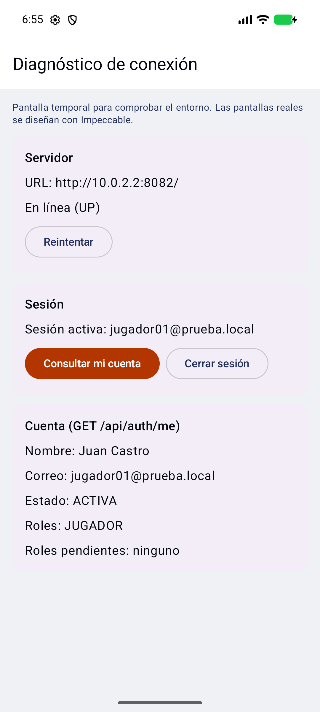

# Desafío Sports

App Android multideporte para los torneos universitarios de la UFPS. Empieza con fútbol sala.

- **Tecnología:** Kotlin + Jetpack Compose (Material 3).
- **De dónde saca todo:** inicia sesión con **Supabase Auth** y consume **BackendCodeCup**, el mismo backend de la web CodeCup.
- **Tres modos sobre una misma cuenta:** Jugador, Árbitro y Creador, más el Visitante sin sesión.

> **Estado: base lista ([MOV-0001](docs/specs/MOV-0001-estructura-base.md)).**
> - Ya está la estructura del proyecto, con la red y la sesión funcionando.
> - Por ahora hay una **pantalla temporal de diagnóstico**: comprueba el backend, inicia sesión y consulta `GET /api/auth/me`.
> - Las pantallas reales se diseñan con Impeccable: [plan de UI](docs/plan-ui-impeccable.md).

<p align="center">
  
</p>

## Requisitos

- **Android Studio** 2026.1 o posterior (el proyecto usa AGP 9.1).
- **JDK 21.** Si no está instalado, Gradle lo descarga.
- **Android SDK 36**, más un emulador o un teléfono con Android 8.0 (API 26) o superior.
  - El emulador necesita **varios GB libres** en disco.
- **BackendCodeCup** corriendo en el puerto **8082**. Se levanta desde el Spring Boot Dashboard de VS Code.

## Configurar

1. Clona el repo.
2. Copia `local.properties.ejemplo` como `local.properties` y completa:
   - `SUPABASE_URL` y `SUPABASE_PUBLISHABLE_KEY`: son las mismas que usa la web (`VITE_SUPABASE_URL` y `VITE_SUPABASE_PUBLISHABLE_KEY`). Pídeselas a David por privado.
   - `API_BASE_URL`: opcional. Por defecto es `http://10.0.2.2:8082/`, el PC visto desde el emulador.
3. Abre la carpeta en Android Studio y deja que sincronice.

> `local.properties` está en `.gitignore`. **Nunca subas claves.** La clave secreta de Supabase (`sb_secret_…`) no va en la app.

## Correr

- **Android Studio:** *Run ▶ app*.
- **Consola:** `gradlew installDebug` (en Windows, `gradlew.bat installDebug`).
- **Teléfono por USB:** corre `adb reverse tcp:8082 tcp:8082` y usa `API_BASE_URL=http://localhost:8082/`.
- **Usuarios de prueba:** los del seed del backend (`jugador01@prueba.local`, `admin01@prueba.local`…). La contraseña está en `SEED_PASSWORD` del `.env` del backend; pídesela a David.

## Probar

```bash
./gradlew testDebugUnitTest      # 31 tests; las 3 pruebas de humo se saltan solas
./gradlew assembleDebug          # compila el APK de debug

# Prueba de humo contra el backend real (con el backend levantado):
DESAFIO_HUMO=1 HUMO_CLAVE=<contraseña del seed> ./gradlew testDebugUnitTest --tests "*BackendRealHumoTest*" --rerun
```

## Cómo contribuir

Se trabaja con **specs (SDD)**: cada cambio nace de una spec en `docs/specs/` y llega con sus pruebas y su evidencia.

1. Elige una spec `aprobada` en el [índice](docs/specs/README.md) y pon tu nombre.
2. Crea la rama `mov-NNNN-<slug>`. Los commits van como `feat(alcance): resumen (MOV-NNNN)`.
3. Escribe los tests primero, implementa y verifica en el emulador.
4. Abre el PR con la plantilla.

Detalle en [`docs/sdd.md`](docs/sdd.md).

## Estructura

```
app/src/main/java/co/edu/ufps/desafiosports/
├── di/            inyección manual (AppContainer)
├── domain/        modelos, interfaces de repositorio, casos de uso (Kotlin puro)
├── data/          Supabase Auth, Retrofit, DTO, repositorios
├── presentacion/  pantallas (Screen + ViewModel + State) y navegación
└── ui/theme/      tema con los tokens del Design System
docs/              arquitectura, SDD, plan de UI, specs y evidencias
```

Documentación completa: [`docs/`](docs/README.md).
